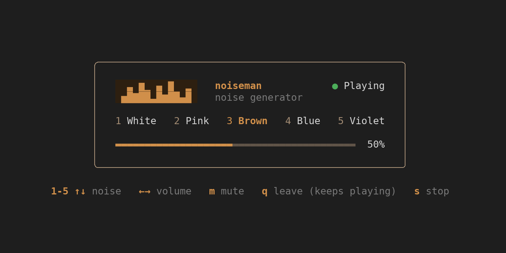

# noiseman

**[▶ Try it in your browser](https://roudy16.github.io/noiseman/)**, with nothing to install.



White, pink, brown, blue or violet noise for focus or sleep, that stays out of your way. A small background player
makes the sound, and you control it from the terminal: a TUI, or one-line commands (`nsm vol +10`, `nsm toggle`)
for scripts and keybindings. A window with a tray icon is optional. Playing takes about 1 MB of private memory and
under 0.1% of one core; muted, the player releases the audio device and sleeps, with no wakeups at all.

The player owns the audio (cpal); the CLI and TUI talk to it over a Unix socket (a named pipe on Windows). The sound comes from a
dependency-free core crate (`crates/core`) that also compiles to WebAssembly for the browser demo (`web/`).
[How it works](https://roudy16.github.io/noiseman/architecture/) has diagrams of the player, the sound core and the
web demo (source `docs/architecture.html`); `DESIGN.md` has the full design.

## Install

**Supported systems:** Linux (PulseAudio or PipeWire via `pipewire-pulse`), macOS (CoreAudio) and Windows 10 or later (WASAPI; build from source for now). The browser demo works on any OS.

### Prebuilt binary

For Linux (x86_64, arm64) and macOS (Apple Silicon, Intel). This installs the latest release, window included, to
`~/.local/bin` with an `nsm` link (an existing `nsm` is left alone, with a warning); on Linux it also installs the
icons and a desktop entry:

```sh
curl -fsSL https://github.com/roudy16/noiseman/releases/latest/download/install.sh | sh
```

The script checks the archive's SHA-256, and that the binary runs on this system, before installing.
`NOISEMAN_INSTALL_DIR` picks another directory and `NOISEMAN_VERSION=v0.1.0` a specific release. You can also download
an archive from [Releases](https://github.com/roudy16/noiseman/releases) yourself, or use `cargo binstall --git
https://github.com/roudy16/noiseman noiseman`. The Linux binaries need glibc 2.35 or newer (Ubuntu 22.04, Debian 12,
Fedora 36) and ALSA's `libasound.so.2`, which desktop systems already have.

### From source

**Prerequisites:** A Rust toolchain (1.85+, edition 2024). On Linux, you also need `pkg-config` and ALSA development headers (`libasound2-dev` on Debian/Ubuntu, `alsa-lib-devel` on Fedora, `alsa-lib` on Arch) for cpal's ALSA fallback.

Clone the repository and install `noiseman` to `~/.cargo/bin`:

```sh
git clone https://github.com/roudy16/noiseman.git
cd noiseman
cargo install --path .
```

To include the optional window and (on Linux) system-tray icon:

```sh
cargo install --path . --features gui
```

Or, with [`just`](https://github.com/casey/just), `just install` builds and installs `noiseman` to `~/.local/bin`
with a shorter `nsm` link, on Linux and macOS. It leaves an existing `nsm` alone and warns instead. On Linux it also
installs hicolor icons and a `.desktop` entry. After `cargo install`, make the link yourself
(`ln -s noiseman ~/.cargo/bin/nsm`) or use a shell alias (`alias nsm=noiseman`).

## Usage

```sh
noiseman                 # open the terminal UI (controls shown at the bottom)
noiseman gui             # open the desktop window and tray (needs --features gui)
noiseman play [KIND]     # start or unmute (white, pink, brown, blue, violet)
noiseman kind KIND       # switch noise kind
noiseman vol N|+N|-N     # set or adjust volume (0-100)
noiseman mute            # mute playback (also: unmute, toggle)
noiseman status          # show current state
noiseman stop            # stop the background player
noiseman daemon          # run the player in the foreground (--muted to start silent)
noiseman --help          # full command reference
```

Keys in the terminal UI and the window: `1`-`5` pick a noise, `↑`/`↓` or `k`/`j` cycle it, `←`/`→` or `h`/`l`
change the volume, `m` or space mutes, `q` or `Esc` leaves (the window hides to the tray, or quits without one), and
`s` stops the player (terminal UI only). The browser demo takes the same noise, volume and mute keys.

## Development

Dev workflows go through [`just`](https://github.com/casey/just) (run `just` alone to list all recipes):

```sh
just setup                 # fetch dependencies and add the wasm32 target
just build                 # compile (use cargo --features gui for the window)
just run [args...]         # run the binary
just test                  # run workspace tests
just fmt                   # format with rustfmt
just lint                  # clippy across default, gui and wasm32 targets
just gates                 # check size, DSP and runtime limits (gates.toml)
just check                 # fmt check, lint, test and gates (run before committing)
just deps                  # check advisories and outdated dependencies (network)
just web                   # build the static browser demo into target/web
just web-serve             # serve the browser demo on http://localhost:8000
just profile [kind] [secs] # profile the DSP into profiles/dsp-<kind>.*
just install               # install binary and nsm link to ~/.local/bin (+ icons, desktop entry on Linux)
just package [target]      # build a release archive (with gui, plus license texts) into target/dist
just clean                 # remove build artifacts
```

## License

MIT, see `LICENSE`, for everything except `vendor/`.

`vendor/` holds two third-party crates under their own licenses, each with small changes (described at the top of
each changed file and in `AGENTS.md`):

- `vendor/cpal`: cpal 0.18.2, Apache License 2.0 (`vendor/cpal/LICENSE`)
- `vendor/pulseaudio`: pulseaudio 0.3.2 by Colin Marc, MIT (`vendor/pulseaudio/LICENSE.md`)

All other dependencies come from crates.io under permissive licenses (MIT, Apache-2.0, BSD-2/3-Clause, ISC, Zlib,
Unlicense, Unicode-3.0); `cargo tree --features gui --target all -e normal,build -f '{p} {l}'` lists them. The web
demo's WebAssembly is built only from `crates/core` and `web/`, with no third-party crates.

## TODO

- [ ] **Windows performance baseline.** The runtime gates (daemon memory,
  threads, CPU, wakeups; TUI and CLI memory) read `/proc`, so `just gates`
  skips them on Windows and only the size and DSP gates run there. Measure the
  daemon on Windows (e.g. working set, private bytes, thread count and context
  switches via the process APIs or `Get-Process`/ETW), playing and muted, and
  either extend `tools/gates.py` or record baselines in `gates.toml`. Do this
  before the GUI scaling change below, so that change is measured against it.
- [ ] **GUI on fractional display scaling.** The window asks for 312x124
  logical pixels, but the bitmap font only draws at whole-number scales, so at
  a fractional OS scale the controls leave an empty band on the right and at
  the bottom (seen on Windows at 250%: a 780x310 window drawn at 2x, 624x248).
  Linux with fractional scaling has the same gap. Fix: pick a whole scale from
  the scale factor (e.g. round 2.5 up to 3), size the window to exactly
  WIN_W x WIN_H times that in physical pixels, and redo it on
  `WindowEvent::ScaleFactorChanged` (moving between monitors). Waits on the
  Windows performance baseline above.
- [ ] **Rain and thunderstorm.** Two more kinds: steady rain, and rain with
  occasional thunder (a noise bed plus sparse droplet transients; thunder as
  rare low-passed rumbles). Each sets its own readable TUI theme, as the
  noise kinds do (e.g. slate-teal for rain, deep indigo with a pale flash
  accent for thunder). Adds `Kind` variants, so it touches the core's
  generators (and their level test), the protocol, the TUI's `1`-`5` keys,
  the GUI and the web demo's kinds and accents.
